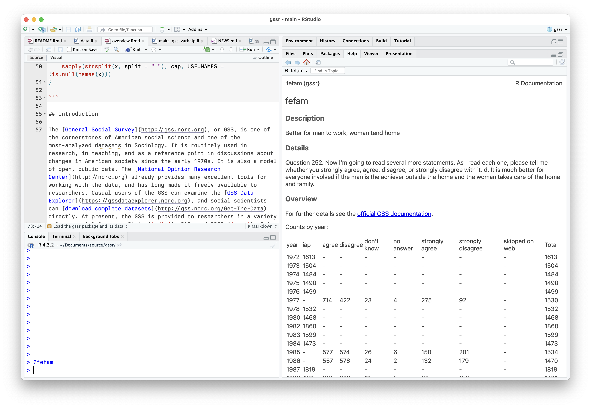
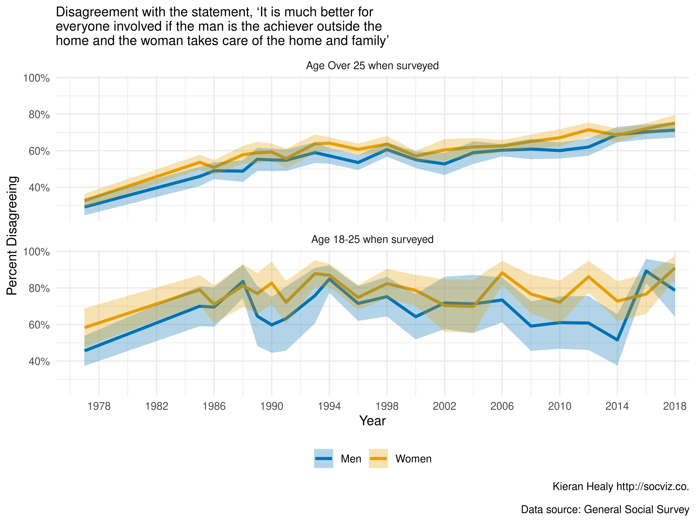

# An Overview of gssr

## Introduction

The [General Social Survey](http://gss.norc.org), or GSS, is one of the
cornerstones of American social science and one of the most-analyzed
datasets in Sociology. It is routinely used in research, in teaching,
and as a reference point in discussions about changes in American
society since the early 1970s. It is also a model of open, public data.
The [National Opinion Research Center](http://norc.org) already provides
many excellent tools for working with the data, and has long made it
freely available to researchers. Casual users of the GSS can examine the
[GSS Data Explorer](https://gssdataexplorer.norc.org), and social
scientists can [download complete
datasets](http://gss.norc.org/Get-The-Data) directly. At present, the
GSS is provided to researchers in a variety of commercial formats: Stata
(`.dta`), SAS, and SPSS (`.sav`). It’s not too difficult to get the data
into R using the [Haven](http://haven.tidyverse.org) package, but it can
be a little annoying to have to do it repeatedly, or across projects.
After doing it one too many times, I got tired of it and I made a
package instead. Currently, the `gssr` package provides Release 1 the
GSS Cumulative Data File (1972-2024); three GSS Three Wave Panel Data
Files (for panels beginning in 2006, 2008, and 2010, respectively); and
the 2020 panel file. The package also integrates codebook information
about variables into R’s help system, allowing them to be accessed via
the help browser or from the console with `?`. The `gssr` package makes
the GSS a little more accessible to users of R, the free software
environment for statistical computing, and thus helps in a small way to
make the GSS even more open than it already is.

### Packages

This article makes use of some additional packages beyond `gssr` itself.
My assumption is that users of `gssr` will most likely use and analyze
the data in conjunction with some combination of
[Tidyverse](https://tidyverse.org) tools and the
[survey](http://r-survey.r-forge.r-project.org/survey/),
[srvyr](https://github.com/gergness/srvyr), and
[panelr](http://panelr.jacob-long.com) packages.

``` r
library(dplyr)
#> 
#> Attaching package: 'dplyr'
#> The following objects are masked from 'package:stats':
#> 
#>     filter, lag
#> The following objects are masked from 'package:base':
#> 
#>     intersect, setdiff, setequal, union
library(ggplot2)
library(haven)
library(tibble)
library(survey)
#> Loading required package: grid
#> Loading required package: Matrix
#> Loading required package: survival
#> 
#> Attaching package: 'survey'
#> The following object is masked from 'package:graphics':
#> 
#>     dotchart
library(srvyr)
#> 
#> Attaching package: 'srvyr'
#> The following object is masked from 'package:stats':
#> 
#>     filter
```

## Load the gssr package and its data

``` r
library(gssr)
#> Package loaded. To attach the GSS data, type data(gss_all) at the console.
#> For the panel data and documentation, type e.g. data(gss_panel08_long) and data(gss_panel_doc).
#> For help on a specific GSS variable, type ?varname at the console.
```

We will begin with the Cumulative Data file (1972-2024). As the startup
message notes, the data objects are not automatically loaded. That is,
we do not use R’s “lazy loading” functionality. This is because the main
GSS dataset is rather large. Instead we load it manually with
[`data()`](https://rdrr.io/r/utils/data.html). For the purposes of this
vignette, because the full Cumulative Data object is big, we will use
just a few columns of it stored in an object called `gss_sub`. But all
the code here will also work with the full dataset object, `gss_all`,
which you can load with the command `data(gss_all)`.

``` r
data(gss_sub)
```

The GSS data comes in a *labelled* format, mirroring the way it is
encoded for Stata and SPSS platforms. The numeric codes are the content
of the column cells. The labeling information is stored as an attribute
of the column.

``` r
gss_sub
#> # A tibble: 75,699 × 20
#>    year         id ballot      age   race    sex     degree  padeg   madeg      
#>    <dbl+lbl> <dbl> <dbl+lbl>   <dbl> <dbl+l> <dbl+l> <dbl+l> <dbl+l> <dbl+lbl>  
#>  1 1972          1 NA(i) [iap] 23    1 [whi… 2 [fem… 3 [bac… 0 [les… NA(i) [iap]
#>  2 1972          2 NA(i) [iap] 70    1 [whi… 1 [mal… 0 [les… 0 [les…     0 [les…
#>  3 1972          3 NA(i) [iap] 48    1 [whi… 2 [fem… 1 [hig… 0 [les…     0 [les…
#>  4 1972          4 NA(i) [iap] 27    1 [whi… 2 [fem… 3 [bac… 3 [bac…     1 [hig…
#>  5 1972          5 NA(i) [iap] 61    1 [whi… 2 [fem… 1 [hig… 0 [les…     0 [les…
#>  6 1972          6 NA(i) [iap] 26    1 [whi… 1 [mal… 1 [hig… 3 [bac…     4 [gra…
#>  7 1972          7 NA(i) [iap] 28    1 [whi… 1 [mal… 1 [hig… 3 [bac…     1 [hig…
#>  8 1972          8 NA(i) [iap] 27    1 [whi… 1 [mal… 3 [bac… 3 [bac…     1 [hig…
#>  9 1972          9 NA(i) [iap] 21    2 [bla… 2 [fem… 1 [hig… 1 [hig…     1 [hig…
#> 10 1972         10 NA(i) [iap] 30    2 [bla… 2 [fem… 1 [hig… 0 [les…     0 [les…
#> # ℹ 75,689 more rows
#> # ℹ 11 more variables: relig <dbl+lbl>, polviews <dbl+lbl>, fefam <dbl+lbl>,
#> #   vpsu <dbl+lbl>, vstrat <dbl+lbl>, oversamp <dbl+lbl>, formwt <dbl+lbl>,
#> #   wtssall <dbl+lbl>, wtssps <dbl+lbl>, sampcode <dbl+lbl>, sample <dbl+lbl>
```

We will use the label information later when recoding the variables
into, say, character or factor variables.

## Descriptive analysis of the data: an example

The GSS is a complex survey. When working with it, we need to take its
structure into account in order to properly calculate statistics such as
the population mean for a variable in some year, its standard error, and
so on. For these tasks we use the `survey` and `srvyr` packages. For
details on `survey`, see Lumley (2010). We will also do some recoding
prior to analyzing the data, so we load several additional `tidyverse`
packages to assist us.

We will examine a topic that was the subject of recent media attention,
in the *New York Times* and elsewhere, regarding the beliefs of young
men about gender roles. Some surveys seemed to point to some recent
increasing conservatism on this front amongst young men. As it happens,
the GSS has a longstanding question named `fefam`, where respondents are
asked to give their opinion on the following statement:

> It is much better for everyone involved if the man is the achiever
> outside the home and the woman takes care of the home and family.

Respondents may answer that they Strongly Agree, Agree, Disagree, or
Strongly Disagree with the statement (as well as refusing to answer, or
saying they don’t know).

### Look at the Variable’s summary

Variable summaries for the cumulative data file are built in to `gssr`
and are integrated into R’s help system. For example, we can type
`?fefam` at the console and have the variable’s documentation appear in
the documentation browser.



Scrolling further down will give a summary of the values the variable
can take.

### Subset the Data

The GSS data retains labeling information (as it was originally imported
via the `haven` package). When working with the data in an analysis, we
will probably want to convert the labeled variables to data types such
as factors. This should be done with care (and not on the whole dataset
all at once). Typically, we will want to focus on some relatively small
subset of variables and examine those. For example, let’s say we want to
explore the `fefam` question. We will subset the data and then prepare
that for analysis. Here we are going to subset `gss_sub` into an object
called `gss_fam` containing just the variables we want to examine, along
with core measures that identify respondents (such as `id` and `year`)
and variables necessary for the survey weighting later (such as
`wtssps`).

``` r
cont_vars <- c("year", "id", "ballot", "age")

cat_vars <- c("race", "sex", "fefam")

wt_vars <- c("vpsu",
             "vstrat",
             "oversamp",
             "formwt",              # weight to deal with experimental randomization
             "wtssps",              # weight variable
             "sampcode",            # sampling error code
             "sample")              # sampling frame and method

my_vars <- c(cont_vars, cat_vars, wt_vars)

gss_fam <- gss_sub |>
  select(all_of(my_vars))

gss_fam
#> # A tibble: 75,699 × 14
#>    year         id ballot      age       race    sex     fefam       vpsu       
#>    <dbl+lbl> <dbl> <dbl+lbl>   <dbl+lbl> <dbl+l> <dbl+l> <dbl+lbl>   <dbl+lbl>  
#>  1 1972          1 NA(i) [iap] 23        1 [whi… 2 [fem… NA(i) [iap] NA(i) [iap]
#>  2 1972          2 NA(i) [iap] 70        1 [whi… 1 [mal… NA(i) [iap] NA(i) [iap]
#>  3 1972          3 NA(i) [iap] 48        1 [whi… 2 [fem… NA(i) [iap] NA(i) [iap]
#>  4 1972          4 NA(i) [iap] 27        1 [whi… 2 [fem… NA(i) [iap] NA(i) [iap]
#>  5 1972          5 NA(i) [iap] 61        1 [whi… 2 [fem… NA(i) [iap] NA(i) [iap]
#>  6 1972          6 NA(i) [iap] 26        1 [whi… 1 [mal… NA(i) [iap] NA(i) [iap]
#>  7 1972          7 NA(i) [iap] 28        1 [whi… 1 [mal… NA(i) [iap] NA(i) [iap]
#>  8 1972          8 NA(i) [iap] 27        1 [whi… 1 [mal… NA(i) [iap] NA(i) [iap]
#>  9 1972          9 NA(i) [iap] 21        2 [bla… 2 [fem… NA(i) [iap] NA(i) [iap]
#> 10 1972         10 NA(i) [iap] 30        2 [bla… 2 [fem… NA(i) [iap] NA(i) [iap]
#> # ℹ 75,689 more rows
#> # ℹ 6 more variables: vstrat <dbl+lbl>, oversamp <dbl+lbl>, formwt <dbl+lbl>,
#> #   wtssps <dbl+lbl>, sampcode <dbl+lbl>, sample <dbl+lbl>
```

### Recode the Subsetted Data

Next, we will do some recoding and create some new variables. We also
create some new variables: age quintiles, a variable flagging whether a
respondent is 25 or younger, recoded `fefam` to binary “Agree” or
“Disagree” (with non-responses dropped).

We begin by figuring out the cutpoints for age quintiles.

``` r
qrts <- quantile(as.numeric(gss_fam$age), 
                 na.rm = TRUE)
qrts
#>   0%  25%  50%  75% 100% 
#>   18   32   44   60   89

quintiles <- quantile(as.numeric(gss_fam$age), 
                      probs = seq(0, 1, 0.2), na.rm = TRUE)

quintiles
#>   0%  20%  40%  60%  80% 100% 
#>   18   30   39   50   64   89
```

Next, we clean up `gss_fam` a bit, discarding some of the label and
missing value information we don’t need. The data in `gss_all` retains
the labeling structure provided by the GSS. Variables are stored
numerically with labels attached to them. Often, when using the data in
R, it will be convenient to convert the categorical variables we are
interested in to character or factor type instead.

``` r
## Recoding
## The convert_agegrp() and capwords() functions seen here are defined
## at the top of the Rmd file used to produce this document.

gss_fam <- gss_fam |>
  mutate(
    # Convert all missing to NA
    across(everything(), haven::zap_missing), 
    # Convert all weight vars to numeric
    across(all_of(wt_vars), as.numeric),
    # Make all categorical variables factors and relabel nicely
    across(all_of(cat_vars), forcats::as_factor),
    across(all_of(cat_vars), \(x) forcats::fct_relabel(x, capwords, strict = TRUE)),
    # Create the age groups
    ageq = cut(x = age, breaks = unique(qrts), include.lowest = TRUE),
    ageq =  forcats::fct_relabel(ageq, convert_agegrp), 
    agequint = cut(x = age, breaks = unique(quintiles), include.lowest = TRUE),
    agequint = forcats::fct_relabel(agequint, convert_agegrp),
    year_f = droplevels(factor(year)),
    young = ifelse(age < 26, "Yes", "No"),
    # Dichotomize fefam
    fefam = forcats::fct_recode(fefam, NULL = "IAP", NULL = "DK", NULL = "NA"),
    fefam_d = forcats::fct_recode(fefam,
                                  Agree = "Strongly Agree",
                                  Disagree = "Strongly Disagree"),
    fefam_n = recode(fefam_d, "Agree" = 0, "Disagree" = 1),
    samplerc = case_when(sample %in% c(3:4) ~ 3, 
                              sample %in% c(6:7) ~ 6,
                              .default = sample))

## Some of the recoded variables
gss_fam |>
  filter(year > 1976) |> 
  select(race:fefam, agequint:fefam_d) |> 
  relocate(year_f)
#> # A tibble: 68,109 × 7
#>    year_f race  sex    fefam             agequint  young fefam_d 
#>    <fct>  <fct> <fct>  <fct>             <fct>     <chr> <fct>   
#>  1 1977   White Female Agree             Age 50-64 No    Agree   
#>  2 1977   White Female Agree             Age 30-39 No    Agree   
#>  3 1977   White Male   Strongly Agree    Age 64+   No    Agree   
#>  4 1977   White Male   Strongly Disagree Age 18-30 No    Disagree
#>  5 1977   White Female Agree             Age 18-30 Yes   Agree   
#>  6 1977   White Male   Disagree          Age 30-39 No    Disagree
#>  7 1977   White Female Agree             Age 64+   No    Agree   
#>  8 1977   White Female Disagree          Age 30-39 No    Disagree
#>  9 1977   White Female Agree             Age 64+   No    Agree   
#> 10 1977   White Female Disagree          Age 39-50 No    Disagree
#> # ℹ 68,099 more rows
```

### Integrate the Survey Weights

At this point we can calculate some percentages, such as the percent of
male and female respondents disagreeing with the `fefam` proposition
each year.

``` r
gss_fam |> 
  group_by(year, sex, young, fefam_d) |> 
  tally() |> 
  drop_na() |> 
  mutate(pct = round((n/sum(n))*100, 1)) |> 
  select(-n) 
#> # A tibble: 192 × 5
#> # Groups:   year, sex, young [96]
#>    year      sex    young fefam_d    pct
#>    <dbl+lbl> <fct>  <chr> <fct>    <dbl>
#>  1 1977      Male   No    Agree     71.8
#>  2 1977      Male   No    Disagree  28.2
#>  3 1977      Male   Yes   Agree     54.3
#>  4 1977      Male   Yes   Disagree  45.7
#>  5 1977      Female No    Agree     66.6
#>  6 1977      Female No    Disagree  33.4
#>  7 1977      Female Yes   Agree     41.9
#>  8 1977      Female Yes   Disagree  58.1
#>  9 1985      Male   No    Agree     53.6
#> 10 1985      Male   No    Disagree  46.4
#> # ℹ 182 more rows
```

However, these calculations do not take the GSS survey design into
account. We set up the data so we can properly calculate population
means and errors and so on. We use the `svyr` package’s wrappers to
`survey` for this.

``` r

options(survey.lonely.psu = "adjust")
options(na.action="na.pass")

gss_svy <- gss_fam |>
    filter(year > 1974) |>
    tidyr::drop_na(fefam_d, young) |>
    mutate(stratvar = interaction(year, vstrat)) |>
    as_survey_design(id = vpsu,
                     strata = stratvar,
                     weights = wtssps,
                     nest = TRUE)
```

The `gss_svy` object contains the same data as `gss_fam`, but
incorporates information about the sampling structure in a way that the
`survey` package’s functions can work with:

``` r
gss_svy
#> Stratified 1 - level Cluster Sampling design (with replacement)
#> With (6111) clusters.
#> Called via srvyr
#> Sampling variables:
#>   - ids: vpsu 
#>   - strata: stratvar 
#>   - weights: wtssps 
#> Data variables: 
#>   - year (dbl+lbl), id (dbl), ballot (dbl+lbl), age (dbl+lbl), race (fct), sex
#>     (fct), fefam (fct), vpsu (dbl), vstrat (dbl), oversamp (dbl), formwt (dbl),
#>     wtssps (dbl), sampcode (dbl), sample (dbl), ageq (fct), agequint (fct),
#>     year_f (fct), young (chr), fefam_d (fct), fefam_n (dbl), samplerc (dbl),
#>     stratvar (fct)
```

### Calculate the survey-weighted statistics

We’re now in a position to calculate some properly-weighted summary
statistics for the variable we’re interested in, for every year it is in
the data.

``` r
## Get the breakdown for every year
out_ff <- gss_svy |>
    group_by(year, sex, young, fefam_d) |>
    summarize(prop = survey_mean(na.rm = TRUE, vartype = "ci")) |> 
  drop_na(sex)
#> Warning: There was 1 warning in `dplyr::summarise()`.
#> ℹ In argument: `prop = survey_mean(na.rm = TRUE, vartype = "ci")`.
#> ℹ In group 1: `year = 1977`, `sex = Male`, `young = "No"`, `fefam_d = Agree`.
#> Caused by warning:
#> ! na.rm argument has no effect on survey_mean when calculating grouped proportions. 
#> This warning is displayed once per session.

out_ff
#> # A tibble: 192 × 7
#> # Groups:   year, sex, young [96]
#>    year      sex    young fefam_d   prop prop_low prop_upp
#>    <dbl+lbl> <fct>  <chr> <fct>    <dbl>    <dbl>    <dbl>
#>  1 1977      Male   No    Agree    0.708    0.662    0.754
#>  2 1977      Male   No    Disagree 0.292    0.246    0.338
#>  3 1977      Male   Yes   Agree    0.544    0.461    0.627
#>  4 1977      Male   Yes   Disagree 0.456    0.373    0.539
#>  5 1977      Female No    Agree    0.673    0.636    0.711
#>  6 1977      Female No    Disagree 0.327    0.289    0.364
#>  7 1977      Female Yes   Agree    0.417    0.312    0.522
#>  8 1977      Female Yes   Disagree 0.583    0.478    0.688
#>  9 1985      Male   No    Agree    0.541    0.489    0.594
#> 10 1985      Male   No    Disagree 0.459    0.406    0.511
#> # ℹ 182 more rows
```

### Plot the Results

We finish with a polished plot of the trends in `fefam` over time, for
men and women in two (recoded) age groups over time.

``` r
theme_set(theme_minimal())

facet_names <- c("No" = "Age Over 25 when surveyed", 
                 "Yes" = "Age 18-25 when surveyed")
fefam_txt <- "Disagreement with the statement, ‘It is much better for\neveryone involved if the man is the achiever outside the\nhome and the woman takes care of the home and family’"

out_ff |> 
  filter(fefam_d == "Disagree") |>
  ggplot(mapping = 
           aes(x = year, y = prop,
               ymin = prop_low, 
               ymax = prop_upp,
               color = sex, 
               group = sex, 
               fill = sex)) +
  geom_line(linewidth = 1.2) +
  geom_ribbon(alpha = 0.3, color = NA) +
  scale_x_continuous(breaks = seq(1978, 2022, 4)) +
  scale_y_continuous(labels = scales::percent_format(accuracy = 1)) +
  scale_color_manual(values = my_colors("bly")[2:1],
                     labels = c("Men", "Women"),
                     guide = guide_legend(title=NULL)) +
  scale_fill_manual(values = my_colors("bly")[2:1],
                    labels = c("Men", "Women"),
                    guide = guide_legend(title=NULL)) +
  facet_wrap(~ young, labeller = as_labeller(facet_names),
             ncol = 1) +
  coord_cartesian(xlim = c(1977, 2022)) +
  labs(x = "Year",
       y = "Percent Disagreeing",
       subtitle = fefam_txt,
       caption = "Kieran Healy http://socviz.co.\n
         Data source: General Social Survey") +
  theme(legend.position = "bottom")
```



## The GSS Three Wave Panels

In addition to the Cumulative Data File, the gssr package also includes
the GSS’s panel data. The current rotating panel design began in 2006. A
panel of respondents were interviewed that year and followed up on for
further interviews in 2008 and 2010. A second panel was interviewed
beginning in 2008, and was followed up on for further interviews in 2010
and 2012. And a third panel began in 2010, with follow-up interviews in
2012 and 2014. The `gssr` package provides three datasets, one for each
of three-wave panels. They are `gss_panel06_long`, `gss_panel08_long`,
and `gss_panel10_long`. The datasets are provided by the GSS in wide
format but (as their names suggest) are packaged here in long format.
The conversion was carried out using the [`panelr`
package](https://panelr.jacob-long.com) and its `long_panel()` function.
Conversion from long back to wide format is possible with the tools
provided in `panelr`.

We load the panel data as before. For example:

``` r
data(gss_panel06_long)

gss_panel06_long
#> # A tibble: 6,000 × 1,572
#>    firstid ballot   form   formwt oversamp sampcode sample samptype vstrat  vpsu
#>    <fct>   <fct>    <fct>   <dbl>    <dbl> <fct>    <fct>  <fct>     <dbl> <dbl>
#>  1 0009    Ballot c Alter…      1        1 501      2000 … 2006 Sa…   1957     2
#>  2 0009    Ballot c Alter…      1        1 501      2000 … 2006 Sa…   1957     2
#>  3 0009    Ballot c Alter…      1        1 501      2000 … 2006 Sa…   1957     2
#>  4 0010    Ballot a Stand…      1        1 501      2000 … 2006 Sa…   1957     2
#>  5 0010    Ballot a Stand…      1        1 501      2000 … 2006 Sa…   1957     2
#>  6 0010    Ballot a Stand…      1        1 501      2000 … 2006 Sa…   1957     2
#>  7 0011    Ballot c Alter…      1        1 501      2000 … 2006 Sa…   1957     2
#>  8 0011    Ballot c Alter…      1        1 501      2000 … 2006 Sa…   1957     2
#>  9 0011    Ballot c Alter…      1        1 501      2000 … 2006 Sa…   1957     2
#> 10 0012    Ballot a Alter…      1        1 501      2000 … 2006 Sa…   1958     1
#> # ℹ 5,990 more rows
#> # ℹ 1,562 more variables: wtpan12 <dbl>, wtpan123 <dbl>, wtpannr12 <dbl>,
#> #   wtpannr123 <dbl>, letin1a <fct>, wave <dbl>, abany <fct>, abdefect <fct>,
#> #   abhlth <fct>, abnomore <fct>, abpoor <fct>, abrape <fct>, absingle <fct>,
#> #   accntsci <fct>, acqasian <fct>, acqattnd <fct>, acqblack <fct>,
#> #   acqbrnda <fct>, acqchild <fct>, acqcohab <fct>, acqcon <fct>,
#> #   acqcops <fct>, acqdems <fct>, acqelecs <fct>, acqfmasn <fct>, …
```

The panel data objects were created by `panelr` but are regular tibbles.
The column names in long format do not have wave identifiers. Rather,
`firstid` and `wave` variables track the cases. The `firstid` variable
is unique for every row and has no missing values. The `id` variable is
from the GSS and tracks individuals within waves.

``` r
gss_panel06_long |> select(firstid, wave, id, sex)
#> # A tibble: 6,000 × 4
#>    firstid  wave id    sex   
#>    <fct>   <dbl> <fct> <fct> 
#>  1 0009        1 9     Female
#>  2 0009        2 3001  Female
#>  3 0009        3 6001  Female
#>  4 0010        1 10    Female
#>  5 0010        2 3002  Female
#>  6 0010        3 6002  Female
#>  7 0011        1 11    Female
#>  8 0011        2 3003  Female
#>  9 0011        3 6003  Female
#> 10 0012        1 12    Male  
#> # ℹ 5,990 more rows
```

We can look at attrition across waves with, e.g.:

``` r
gss_panel06_long |> 
  select(wave, id) |>
  group_by(wave) |>
  summarize(observed = n_distinct(id),
            missing = sum(is.na(id)))
#> # A tibble: 3 × 3
#>    wave observed missing
#>   <dbl>    <int>   <int>
#> 1     1     2000       0
#> 2     2     1537     464
#> 3     3     1277     724
```

## References

Lumley, Thomas (2010). *Complex Surveys: A Guide to Analysis Using R*.
New York: Wiley.
